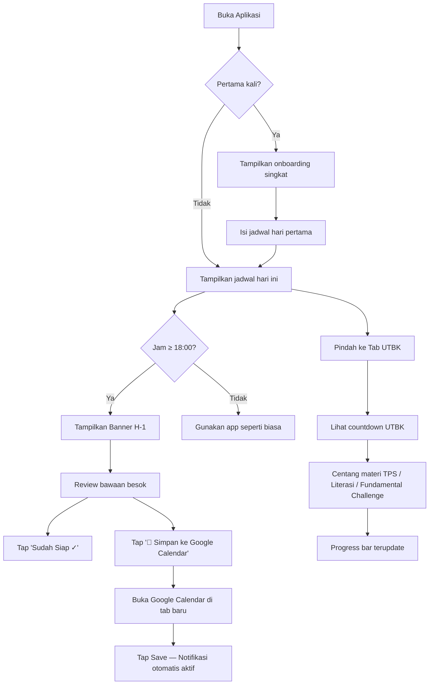

# 📋 PLAN.md — JadwalNya Radif

> **Blueprint MVP** · Mobile-First Web App  
> Manajemen Jadwal Sekolah & Persiapan UTBK

---

## 1. Ringkasan Proyek

| Item | Detail |
|---|---|
| **Nama Aplikasi** | JadwalNya Radif |
| **Tipe** | Single-Page Application (SPA), mobile-first |
| **Target Pengguna** | Siswa SMA/sederajat yang mempersiapkan UTBK |
| **Tech Stack** | HTML · CSS · Vanilla JavaScript (tanpa framework) |
| **Penyimpanan** | `localStorage` — tanpa backend, tanpa login |
| **Hosting Target** | Statis (GitHub Pages / Netlify / buka langsung di browser) |

---

## 2. Arsitektur & Struktur File

```
jadwalnya-radif/
├── index.html          ← Entry point, shell navigasi
├── css/
│   └── style.css       ← Stylesheet utama (mobile-first responsive)
├── js/
│   ├── app.js          ← Inisialisasi app, routing antar tab
│   ├── jadwal.js       ← Modul manajemen jadwal & bawaan
│   ├── utbk.js         ← Modul latihan UTBK & countdown
│   └── storage.js      ← Abstraksi LocalStorage (CRUD helper)
└── assets/
    └── icons/          ← Ikon SVG inline / favicon
```

> Vanilla JS dipilih agar ringan, tanpa build step, dan mudah di-deploy sebagai file statis. Seluruh state disimpan di `localStorage`.

---

## 3. Navigasi & Layout

### 3.1 Bottom Navigation Bar (Mobile)

Aplikasi menggunakan **tab-based navigation** di bagian bawah layar dengan 3 tab utama:

| Tab | Ikon | Label | Keterangan |
|---|---|---|---|
| 1 | 📅 | **Jadwal** | Jadwal mingguan + daftar bawaan |
| 2 | 📚 | **UTBK** | Checklist materi & countdown |
| 3 | ⚙️ | **Pengaturan** | Reset data, info aplikasi |

### 3.2 Responsivitas

- **Mobile (< 768px):** Layout utama, bottom nav bar sticky.
- **Tablet/Desktop (≥ 768px):** Sidebar kiri menggantikan bottom nav, konten di area utama.

---

## 4. Fitur Detail

### 4.1 Manajemen Jadwal Sekolah & Bawaan (H-1)

#### 4.1.1 Input Jadwal Mingguan

- Pengguna memilih **hari** (Senin–Minggu) lalu mengisi daftar mata pelajaran untuk hari tersebut.
- Setiap entri mata pelajaran memiliki field:

  | Field | Tipe | Wajib | Contoh |
  |---|---|---|---|
  | Nama Mapel | Text | ✅ | "Matematika" |
  | Jam | Time range | ❌ | 07:00 – 08:30 |
  | Buku/Bawaan | Tag list (multi-input) | ❌ | "Buku Paket", "Penggaris", "Jangka" |
  | Catatan | Textarea | ❌ | "Bawa tugas PR halaman 45" |

- Mapel bisa **ditambah, diedit, dihapus, dan diurutkan ulang** (drag atau tombol ↑↓).
- Tampilan default: jadwal hari ini, dengan navigasi cepat ke hari lain via pill/tab horizontal.

#### 4.1.2 Sistem Peringatan H-1

- **Banner peringatan** muncul otomatis di bagian atas halaman Jadwal mulai **pukul 18:00 (sore)** sehari sebelumnya.
- Isi banner:
  ```
  🔔 Besok (Selasa) ada 5 mapel.
  Jangan lupa siapkan: Buku Fisika, Penggaris, Seragam Olahraga, ...
  ```
- Banner menampilkan **ringkasan semua bawaan unik** dari seluruh mapel keesokan hari.
- Tombol **"Sudah Siap ✓"** untuk menutup/dismiss banner (state disimpan per hari).
- Logika H-1:
  - Deteksi hari sekarang → ambil jadwal hari berikutnya.
  - Jika hari ini Minggu → tampilkan jadwal Senin.
  - Jika belum pukul 18:00, banner disembunyikan (opsional: bisa diaktifkan manual).

##### 🔗 Tombol "Simpan Pengingat ke Google Calendar"

Di dalam banner H-1, disediakan tombol tambahan **"📅 Simpan ke Google Calendar"** yang berfungsi sebagai solusi agar pengingat tetap berbunyi di HP meskipun aplikasi web sedang ditutup. Mekanisme:

- Tombol menghasilkan **URL Google Calendar Event Generator** (`https://calendar.google.com/calendar/render?action=TEMPLATE&...`) yang otomatis terisi:
  - **Judul (title):** `📚 Persiapan Besok: [Hari] — [Jumlah] Mapel`
  - **Deskripsi (details):** Daftar lengkap mapel besok + semua barang bawaan per mapel, contoh:
    ```
    Jadwal Besok (Selasa):
    1. Matematika (07:00-08:30) — Buku Paket, Penggaris
    2. Fisika (08:30-10:00) — Buku, Kalkulator
    3. B. Inggris (10:15-11:45) — Kamus, Buku Tugas
    
    🎒 Bawaan yang perlu disiapkan:
    Buku Paket, Penggaris, Buku Fisika, Kalkulator, Kamus, Buku Tugas
    ```
  - **Waktu event:** Malam ini pukul **19:00–19:30** (default, sebagai waktu persiapan).
  - **Reminder:** 30 menit sebelum event (otomatis dari Google Calendar).
- Saat diklik, URL terbuka di tab baru → pengguna tinggal tap **"Save"** di Google Calendar.
- **Keuntungan:** Notifikasi push dari Google Calendar akan berbunyi di HP, bahkan jika aplikasi web ditutup. Tidak perlu Service Worker atau izin notifikasi browser.

> **⚠️ Penting:** Peringatan H-1 banner bersifat **pasif** (muncul saat buka app setelah jam 18:00). Tombol Google Calendar adalah solusi **aktif** agar notifikasi tetap sampai ke HP pengguna.

#### 4.1.3 Tampilan Jadwal & Checklist Tugas

- **Kartu per mapel** tersusun vertikal, menampilkan:
  - Waktu mulai & selesai (misal: 07:00 – 08:30)
  - Nama Mapel (font besar dan tebal)
  - Badge bawaan (chip/tag bernuansa biru muda)
  - **Checklist Tugas/Catatan Interaktif:** Opsi checkbox pada setiap tugas/PR atau status kesiapan mapel. Jika sudah dilaksanakan, pengguna dapat mencentangnya sehingga teks tercoret dan status berubah menjadi "Selesai ✓". State checklist tersimpan otomatis di LocalStorage.
  - **Tombol "Simpan ke Google Calendar" per Mapel:** Tombol khusus di setiap kartu mata pelajaran yang menghasilkan URL Google Calendar dengan slot waktu terpisah sesuai jam pelajaran tersebut, lengkap dengan daftar perlengkapan dan catatan tugas di deskripsinya.
- Indikator hari aktif di pill navigation (Senin – Minggu).
- Ringkasan progres tugas di header hari aktif (misal: "3/4 Tugas Selesai").
- Warna aksen berbeda untuk setiap hari (subtle, pada header/border).

---

### 4.2 Modul Latihan UTBK / Target Harian

#### 4.2.1 Daftar Materi UTBK

Materi UTBK dibagi dalam **3 kategori utama** dengan sub-topik default bawaan (pengguna bisa menambah/mengedit):

**TPS (Tes Potensi Skolastik):**

| # | Sub-Materi |
|---|---|
| 1 | Penalaran Umum |
| 2 | Pengetahuan & Pemahaman Umum |
| 3 | Kemampuan Memahami Bacaan & Menulis |
| 4 | Pengetahuan Kuantitatif |

**Literasi (Tes Literasi):**

| # | Sub-Materi |
|---|---|
| 1 | Literasi dalam Bahasa Indonesia |
| 2 | Literasi dalam Bahasa Inggris |
| 3 | Penalaran Matematika |

**Fundamental Challenge:**

| # | Sub-Materi |
|---|---|
| 1 | *(Kustom — ditambahkan oleh pengguna)* |

- Kategori **Fundamental Challenge** adalah kategori khusus yang sepenuhnya **user-defined**.
- Pengguna dapat **menambah item baru** ke dalam kategori ini dengan mengisi:
  - **Nama topik** (wajib) — contoh: "Logika Dasar", "Pola Bilangan", "Silogisme"
  - **Deskripsi** (opsional, textarea) — contoh: "Latihan 50 soal pola bilangan dari bank soal 2024"
- Setiap item dalam Fundamental Challenge bisa **diedit dan dihapus**.
- Deskripsi ditampilkan di bawah nama topik dalam kartu/list (collapsible agar tidak memakan ruang).
- Item Fundamental Challenge juga muncul di **checklist harian** sama seperti materi TPS dan Literasi.

> Daftar TPS & Literasi berdasarkan format UTBK-SNBT terbaru. Fundamental Challenge memungkinkan pengguna menambahkan materi latihan personal yang tidak tercakup dalam kategori standar.

#### 4.2.2 Checklist Target Harian

- Setiap sub-materi (TPS, Literasi, **dan Fundamental Challenge**) bisa di-**checklist** per hari sebagai target belajar harian.
- Tampilan:
  - List dengan checkbox di kiri, dikelompokkan per kategori.
  - Saat dicentang → teks coret (strikethrough) + efek visual (fade/hijau).
  - Di bagian atas: **progress bar** menunjukkan `X / Y materi selesai hari ini`.
- History progres tersimpan per tanggal (format: `YYYY-MM-DD`).
- Tombol **"Reset Hari Ini"** untuk mengulang checklist.

#### 4.2.3 Statistik Progres Sederhana & Streak Dinamis

- Tampilan ringkasan di atas daftar checklist:
  ```
  📊 Progres Hari Ini: 3/9 materi (33%)
  🔥 Streak: 5 Hari
  ```
- **Streak counter dinamis**: dihitung otomatis berdasarkan riwayat penyelesaian materi hari demi hari:
  - Otomatis bertambah `+1` saat menyelesaikan minimal 1 materi hari ini dibandingkan kemarin.
  - Tetap bertahan (mempertahankan angka kemarin) saat membuka aplikasi di hari baru sebelum mencentang materi.
  - Otomatis reset ke `0` jika terlewat satu hari penuh tanpa aktivitas belajar.

#### 4.2.4 Countdown UTBK

- **Countdown timer** besar dan mencolok di bagian atas tab UTBK.
- Format tampilan:
  ```
  ⏳ H-215 menuju UTBK
  (Rabu, 21 Juni 2027)
  ```
- Tanggal UTBK bisa **diatur manual** oleh pengguna di halaman Pengaturan.
- Jika tanggal belum diset → tampilkan prompt untuk mengisi.
- Jika tanggal sudah lewat → tampilkan pesan selesai:
  ```
  🎉 UTBK sudah berlalu! Semangat hasilnya!
  ```

---

### 4.3 Penyimpanan Lokal (LocalStorage)

#### 4.3.1 Struktur Data

```jsonc
// Key: "jadwalnya_radif_data"
{
  "jadwal": {
    "senin": [
      {
        "id": "uuid-1",
        "mapel": "Matematika",
        "jam_mulai": "07:00",
        "jam_selesai": "08:30",
        "bawaan": ["Buku Paket", "Penggaris"],
        "catatan": "PR halaman 45"
      }
      // ...
    ],
    "selasa": [ /* ... */ ],
    "rabu": [ /* ... */ ],
    "kamis": [ /* ... */ ],
    "jumat": [ /* ... */ ],
    "sabtu": [ /* ... */ ],
    "minggu": [ /* ... */ ]
  },
  "utbk": {
    "tanggal_target": "2027-06-21",
    "materi": [
      {
        "id": "uuid-2",
        "kategori": "TPS",
        "nama": "Penalaran Umum",
        "deskripsi": null,
        "is_custom": false
      },
      {
        "id": "uuid-10",
        "kategori": "Fundamental Challenge",
        "nama": "Logika Dasar",
        "deskripsi": "Latihan 50 soal logika dari bank soal 2024",
        "is_custom": true
      }
      // ...
    ],
    "progres": {
      "2026-11-18": ["uuid-2", "uuid-5", "uuid-10"],
      "2026-11-17": ["uuid-2", "uuid-3", "uuid-7"]
    },
    "streak": 5
  },
  "pengaturan": {
    "h1_dismissed": {
      "2026-11-18": true
    }
  }
}
```

#### 4.3.2 Storage Helper (`storage.js`)

| Fungsi | Deskripsi |
|---|---|
| `loadData()` | Baca & parse data dari localStorage, return default jika kosong |
| `saveData(data)` | Stringify & simpan ke localStorage |
| `resetAllData()` | Hapus semua data (dengan konfirmasi) |
| `exportData()` | Download data sebagai file `.json` |
| `importData(file)` | Upload file `.json` untuk restore data |

> **⚠️ Perhatian:** `localStorage` terbatas ~5 MB dan bisa terhapus jika pengguna membersihkan cache browser. Fitur **export/import JSON** ditambahkan sebagai backup manual.

---

## 5. Halaman Pengaturan

| Opsi | Fungsi |
|---|---|
| Atur Tanggal UTBK | Date picker untuk target countdown |
| Export Data | Download backup `.json` |
| Import Data | Upload restore `.json` |
| Kosongkan Semua Jadwal | Mengosongkan seluruh mapel Senin–Minggu agar bisa mulai mengisi jadwal asli |
| Reset Dummy Data | Kembalikan semua data ke contoh bawaan aplikasi |
| Tentang Aplikasi | Versi, kredit, deskripsi singkat |

---

## 6. Desain & UI/UX

### 6.1 Prinsip Desain

- **Mobile-first**: Desain utama untuk layar 360–414px.
- **Minimalis & bersih**: Warna netral dengan aksen warna untuk elemen interaktif.
- **Tipografi jelas**: Font sans-serif, ukuran mudah dibaca di mobile.
- **Interaksi cepat**: Semua aksi utama bisa dilakukan dalam ≤ 2 tap.

### 6.2 Skema Warna

Tema utama: **Orange & Biru Muda** 🟠🔵

| Elemen | Warna | Kode |
|---|---|---|
| Primary (Orange) | 🟠 Aksen utama, tombol, header, nav aktif | `#F97316` |
| Primary Hover/Dark | 🟠 Variasi gelap untuk hover & fokus | `#EA580C` |
| Primary Light | 🟡 Background ringan, highlight | `#FFF7ED` |
| Secondary (Biru Muda) | 🔵 Aksen sekunder, badge, link, pill hari | `#38BDF8` |
| Secondary Light | 🔵 Background secondary, kartu UTBK | `#E0F2FE` |
| Background | ⬜ Latar belakang utama | `#FFFBF5` (warm white) |
| Card Background | ⬜ Latar kartu | `#FFFFFF` |
| Success/Checklist | 🟢 Centang selesai, progress bar | `#10B981` |
| Warning/H-1 Banner | 🟡 Banner peringatan (amber-orange) | `#FB923C` |
| Text Primary | ⬛ Teks utama | `#1C1917` (warm dark) |
| Text Secondary | Teks pendukung | `#78716C` (warm gray) |
| Border/Divider | Garis pembatas | `#FED7AA` (orange tint) |

### 6.3 Wireframe Tampilan Utama (Jadwal)

```
┌──────────────────────────┐
│  🍊 JadwalNya Radif      │  ← Header (orange gradient)
├──────────────────────────┤
│  🔔 Banner H-1 (amber)   │  ← Muncul ≥ 18:00
│  📅 Simpan ke GCal        │  ← Tombol Google Calendar
├──────────────────────────┤
│ [Sen][Sel][Rab]...[Min]  │  ← Pill navigation 7 hari
├──────────────────────────┤
│  ┌────────────────────┐  │
│  │ 07:00 - 08:30      │  │
│  │ MATEMATIKA         │  │  ← Kartu Mapel
│  │ 📦 Buku, Penggaris │  │
│  │ 📝 PR hal. 45      │  │
│  └────────────────────┘  │
│  ┌────────────────────┐  │
│  │ 08:30 - 10:00      │  │
│  │ FISIKA             │  │
│  │ 📦 Buku, Kalkulator│  │
│  └────────────────────┘  │
│          ...             │
├──────────────────────────┤
│  📅       📚       ⚙️    │  ← Bottom nav (orange active)
└──────────────────────────┘
```

---

## 7. Alur Pengguna (User Flow)



---

## 8. Milestone Pengembangan

| Fase | Deliverable | Estimasi |
|---|---|---|
| **Fase 1** | Struktur HTML + CSS layout (orange & biru muda) + navigasi tab | Langkah 1 |
| **Fase 2** | `storage.js` — abstraksi localStorage | Langkah 2 |
| **Fase 3** | `jadwal.js` — CRUD jadwal Senin–Minggu + bawaan + tampilan | Langkah 3 |
| **Fase 4** | Logika peringatan H-1 + banner + Google Calendar URL generator | Langkah 4 |
| **Fase 5** | `utbk.js` — checklist materi (TPS, Literasi, Fundamental Challenge) + progress | Langkah 5 |
| **Fase 6** | Countdown UTBK + streak | Langkah 6 |
| **Fase 7** | Halaman Pengaturan + export/import | Langkah 7 |
| **Fase 8** | Polish UI, testing, responsive check | Langkah 8 |

---

## 9. Batasan MVP & Potensi Upgrade

### Tidak termasuk dalam MVP:
- ❌ Push notification native (digantikan oleh integrasi Google Calendar)
- ❌ Akun pengguna / backend
- ❌ Sinkronisasi antar perangkat
- ❌ Dark mode
- ❌ Simulasi soal UTBK aktual

### Status Pengembangan Terkini:
- ✅ PWA (Progressive Web App) dengan manifest.json & sw.js (Siap install di Home Screen HP)
- ✅ Offline Support 100% menggunakan smart caching (Cache-First & Network-First Fallback)
- ✅ Google Calendar Direct Slot Event Generator
- ✅ Dynamic Streak Counter & Checklist UTBK
- ✅ Edit Jadwal & Kosongkan Jadwal

### Potensi upgrade masa depan:
- ✨ Dark mode toggle
- ✨ Statistik mingguan/bulanan dengan chart
- ✨ Berbagi jadwal via link/QR code
- ✨ Timer pomodoro untuk sesi belajar

---

> **📌 Dokumen ini adalah blueprint yang perlu disetujui sebelum memulai pengembangan kode.** Silakan tinjau dan berikan feedback atau persetujuan untuk melanjutkan ke fase coding.
